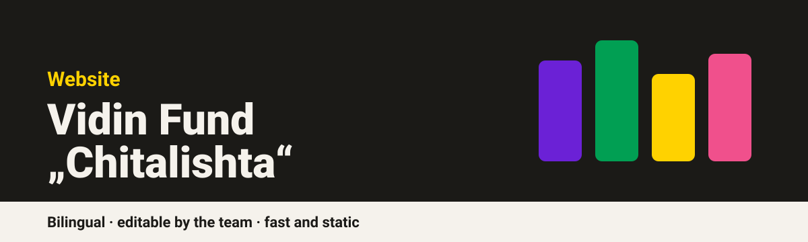
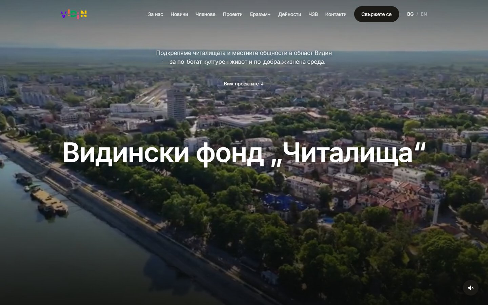
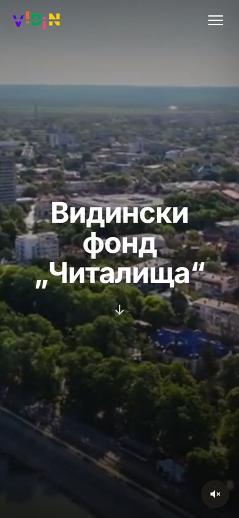

 

 

**The website of Vidin Fund "Chitalishta", an association supporting community cultural centres in Vidin region, Bulgaria. Live at [fundchitalishta.com](https://www.fundchitalishta.com).**

> **Showcase repository.** This page presents the project and the engineering behind it. The source code is private.

---

## Screens

## What it does

| | |
|---|---|
| **Full-screen video hero** | An aerial view of Vidin with a sound toggle |
| **Clear structure** | About, news, members, projects, Erasmus+, activities, FAQ and contacts |
| **Bulgarian and English** | A language switch on every page |
| **Editable by the team** | Staff update news, projects and photos in a CMS, with no code |
| **Works on phones** | Responsive layout and a mobile menu |
| **Privacy page** | A dedicated privacy policy |

## Engineering

| Area | Approach |
|---|---|
| Front end | Hand-written static HTML, CSS and JavaScript with bilingual content |
| Content | Git-based CMS: edits become commits, with the content stored as JSON |
| Authentication | A small Cloudflare Worker handles the CMS sign-in flow |
| Images | Uploads are converted to WebP and resized automatically |
| Performance | Cache headers tuned per file type: long-lived for add-only media, revalidated for code |
| Hosting | Static hosting on Cloudflare, with a robots file and sitemap |

## Design language

<table>
<tr>
<td bgcolor="#1B1A17" width="130" align="center"><b>#1B1A17</b> ink</td>
<td bgcolor="#F5F2EC" width="130" align="center"><b>#F5F2EC</b> warm paper</td>
<td bgcolor="#019F53" width="130" align="center"><b>#019F53</b> green</td>
<td bgcolor="#6B21D6" width="130" align="center"><b>#6B21D6</b> violet</td>
<td bgcolor="#FFD200" width="130" align="center"><b>#FFD200</b> yellow</td>
</tr>
</table>

A neutral, editorial layout with the colourful blocks of the Vidin logo as the only accent.

---

Built by [@ivaylozhivkov88](https://github.com/ivaylozhivkov88)

